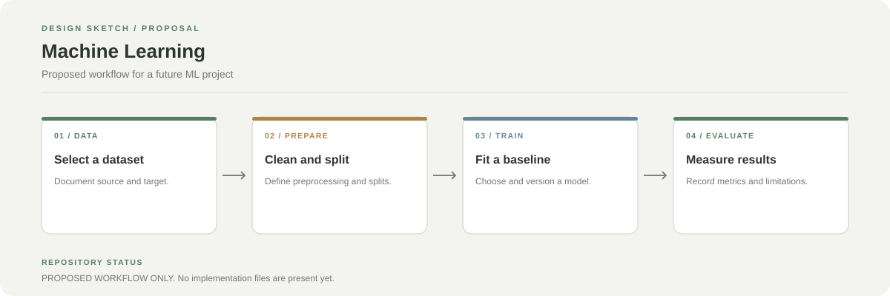

# Machine Learning

This repository is currently empty. No model, dataset, notebook, or executable workflow is included yet.



## Suggested next steps

1. Add a short problem statement and intended target.
2. Document the dataset source, licence, and features.
3. Start with a reproducible baseline notebook or script.
4. Keep train, validation, and test data separate.
5. Report suitable metrics, baseline comparisons, and known limitations.

## Proposed layout

```text
.
├── data/          # Local or documented dataset location
├── notebooks/     # Exploration and experiments
├── src/           # Reusable preprocessing and training code
├── tests/         # Data and model checks
├── requirements.txt
└── README.md
```

The diagram is a proposal only. It does not describe existing code.
