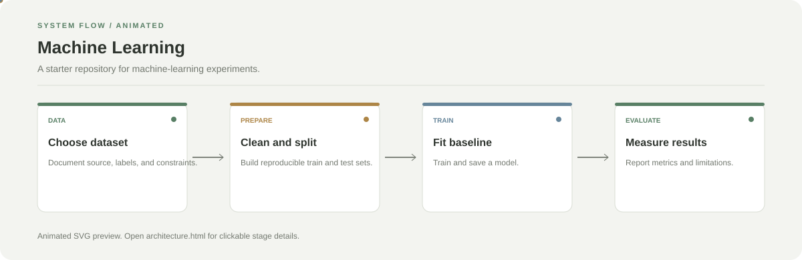

# Machine Learning

**A starter repository for machine-learning experiments.**

[](https://github.com/chyk2468/Machine-learning-ML-)

## 1. Project Title & Tagline

A starter repository for machine-learning experiments.

## 2. Problem Statement

Machine-learning experiments are easier to reproduce when data preparation, training, evaluation, and limitations are documented as one workflow.

## 3. Project Preview

Add a real screenshot, GIF, or public demo after running the project. For a starter repository, show the first working experiment here.

[Open interactive architecture](architecture.html)

## 4. Overview

The project follows a clear workflow from input collection through processing to a reviewable output. See the repository entry point and configuration for the exact implementation details.

## 5. Key Features

- Use a clear problem statement and dataset source.
- Separate training and evaluation data.
- Compare a baseline model with later experiments.
- Record metrics and known limitations.

## 6. Architecture / Workflow



Open the [interactive architecture explorer](architecture.html) to select a stage and read its role.

## 7. Tech Stack

Python, Jupyter, and the libraries required by the selected experiment

## 8. Installation & Setup

```bash
git clone https://github.com/chyk2468/Machine-learning-ML-.git
cd Machine-learning-ML-
python -m venv .venv
```

## 9. Usage

This repository is currently a starter project. Add the dataset and executable notebook or training script before describing any model results as implemented.

## 10. Project Structure

Suggested layout: `data/`, `notebooks/`, `src/`, `tests/`, `requirements.txt`, and `README.md`.

## 11. Results & Demo

No implementation results are claimed yet. Add a baseline, evaluation metrics, and a reproducible run log when the experiment is implemented.

## 12. Future Enhancements

- Add a documented dataset and task.
- Implement a baseline notebook or script.
- Add tests for data preparation.
- Report evaluation metrics and limitations.

## 13. License

Add a LICENSE file if you intend to grant reuse or redistribution permissions.
